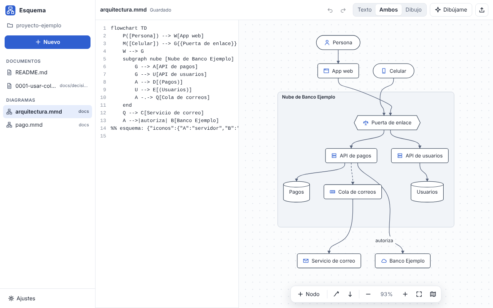
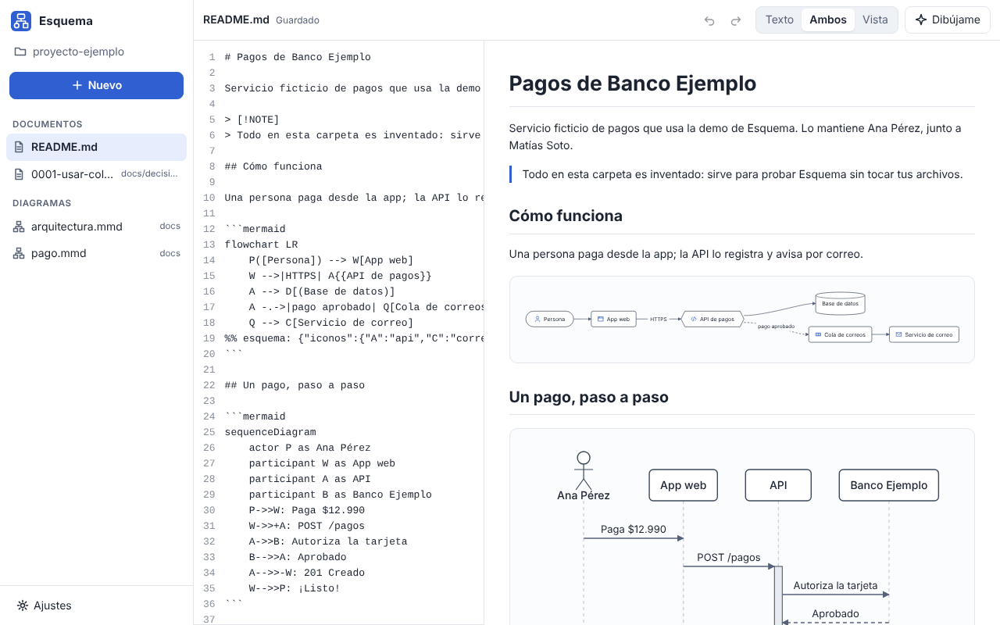
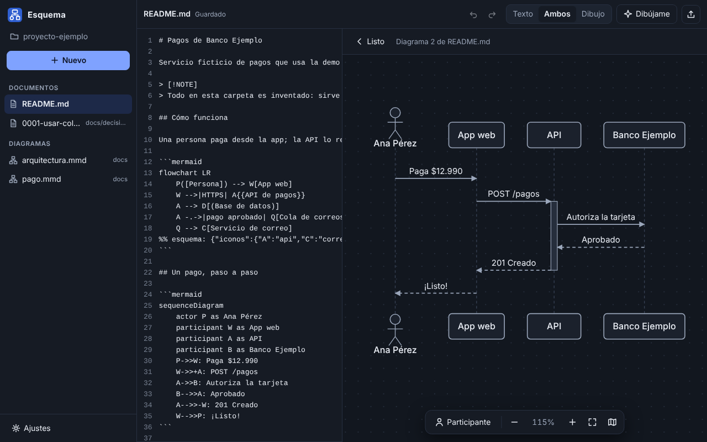
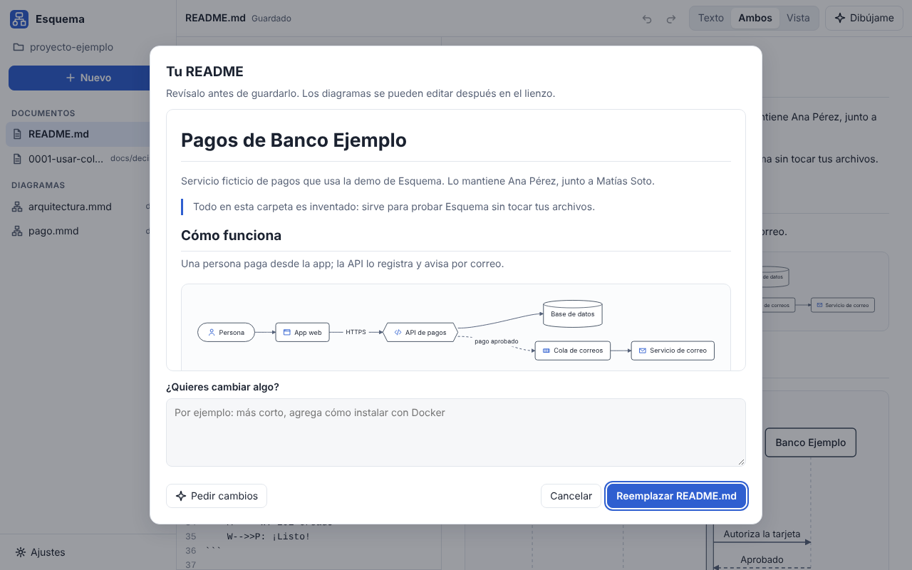
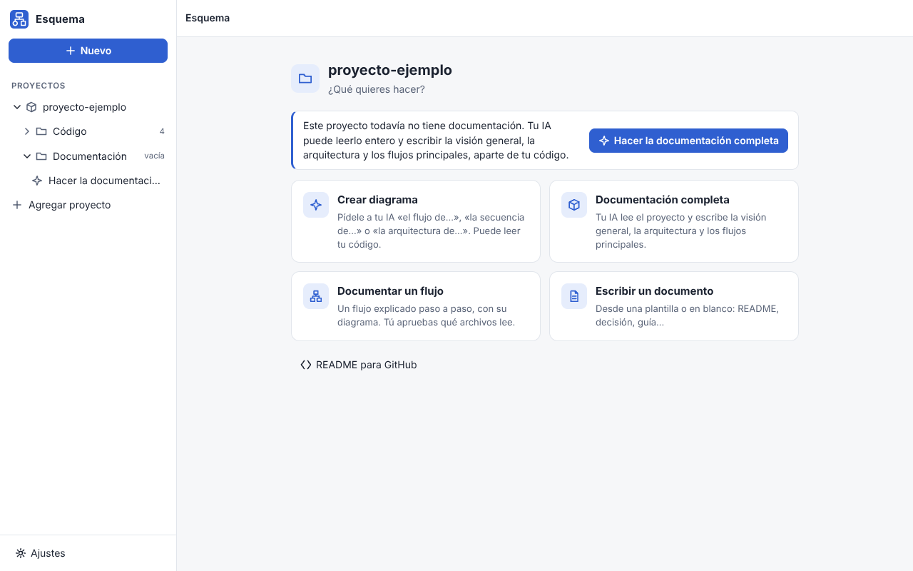
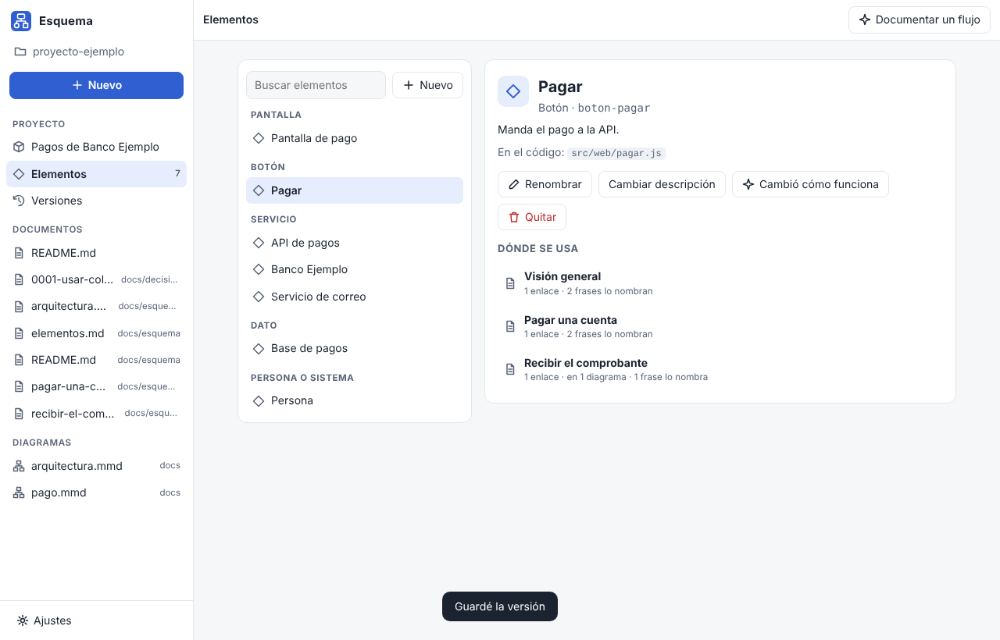
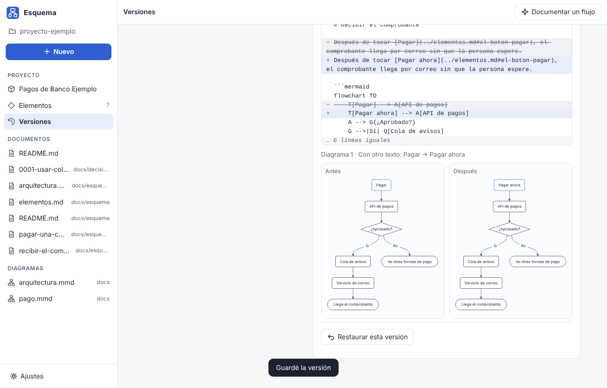
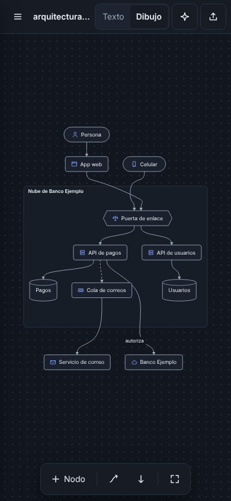
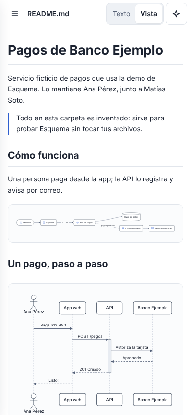
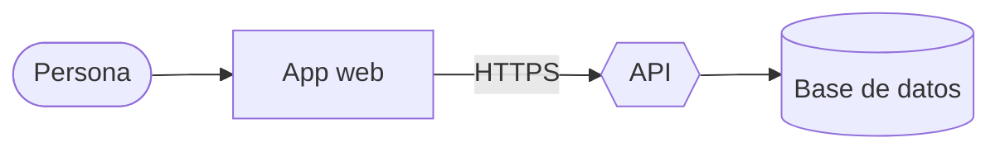

<p align="center"></p>

<h1 align="center">Esquema</h1>

<p align="center"><b>Diagramas y documentación que GitHub ya entiende.</b><br>
Escribe Mermaid o dibuja en el lienzo. Los dos se mantienen al día. Gratis, abierto y en tu computador.</p>

<p align="center"><a href="https://esquema-app.github.io/esquema/"><b>Sitio y descargas</b></a> · <a href="https://esquema-app.github.io/esquema/demo/">Pruébala en el navegador</a> · <a href="https://github.com/esquema-app/esquema-catalogo">Plantillas de la comunidad</a> · <a href="https://github.com/esquema-app/esquema/wiki">Wiki</a> · <a href="https://github.com/esquema-app/esquema/discussions">Comunidad</a> · <a href="#english">English below</a></p>



## Qué es

Esquema es una app para hacer **diagramas de flujo, de secuencia y de arquitectura**, y la **documentación** que los acompaña. Usa el
formato que GitHub ya muestra: Markdown con bloques ```` ```mermaid ```` y archivos `.mmd`. Además, suma lo que a Mermaid le falta:

- **Edición en dos sentidos.**
  - Escribe el texto con autocompletar. Los errores son claros y en español, por ejemplo: «Línea 4: falta cerrar «]» en
    «B[Pagar». Prueba: B[Pagar]».
  - O dibuja: doble clic para crear o renombrar, arrastra desde un nodo para conectarlo, mueve lo que quieras (queda fijado), Supr
    para borrar, ⌘Z para deshacer.
  - Cada cambio aparece al tiro en el texto. Esquema toca solo esa línea.
- **Un motor propio, rápido y liviano.** Es entre 40 y 100 veces más rápido que Mermaid, sin dependencias ([medición](#rendimiento)).
- **Documentos con diagramas que se editan en el lugar.** La vista previa es en vivo. Los enlaces nunca cargan nada de internet.
- **Tu carpeta, de un vistazo.** A la izquierda está la carpeta entera, como árbol. Cada subcarpeta se abre y se cierra. Al elegir la
  carpeta, el **Inicio** ofrece cuatro cosas: **Crear diagrama**, **Documentación completa**, **Documentar un flujo** y **Escribir un
  documento**.
- **Tu IA te ayuda** (Claude Code, Codex o Gemini, con tu cuenta).
  - Pídele «el flujo de…», «la secuencia de…» o «la arquitectura de…». El tipo de diagrama sale de cómo lo pides.
  - **Crear diagrama** puede leer el código de la carpeta o solo tu descripción. Antes de enviar, ves exactamente qué va.
  - «Dibújame» cambia el diagrama que tienes abierto.
  - El asistente **README para GitHub** escribe el README de tu proyecto con la lista de archivos. Usa solo los nombres, respeta
    `.gitignore` y nunca envía secretos.
  - Cada cambio de la IA tiene su tarjeta con **«Quitar este cambio»**.
- **Proyectos: documentación que crece con tu código, aparte del código.**
  - Agrega los proyectos que quieras. Cada proyecto es la carpeta de un repositorio.
  - Esquema lee el README, las guías, los archivos y la historia de git. Esto no usa IA: nada sale de tu computador.
  - Tu IA escribe la visión general, la arquitectura y los flujos principales en **su propia carpeta**, `~/Esquema/<proyecto>/`, con
    su propio historial de versiones. Tu repo no cambia.
  - Con **«Pasar al proyecto»** eliges qué documentos copiar al repo. Si un documento ya existe, ves la diferencia y decides si lo
    reemplazas.
  - Después, pídele un flujo específico, por ejemplo «cómo se graba una reunión». Si necesita leer archivos del código, te pregunta
    cuáles. Antes de cada envío, ves exactamente qué se manda.
  - Con **«Revisión a fondo»**, tu IA puede leer (solo leer) toda la carpeta del código. Nunca lee tus `.env`, tus llaves ni `.git`.
  - A la izquierda, cada proyecto es una carpeta con su **Código** y su **Documentación**. La documentación te dice **qué le falta**
    (visión, arquitectura, flujos, elementos) y lo completa con un botón.
- **Documentar no te deja esperando a ciegas.**
  - Tu IA trabaja por etapas: revisa los archivos, lee el código, arma un plan, escribe los documentos de a dos y guarda una versión.
  - Ves en vivo qué archivo lee, cuántos lleva y cómo va cada documento.
  - Cada documento queda guardado apenas está listo, aunque cierres la ventana. Puedes seguir trabajando.
  - Si un documento falla, Esquema lo reintenta solo.
  - **«Código»** muestra todos los archivos del proyecto. Marca los que leyó tu IA. El código no se abre en Esquema: lo lee tu IA.
  - La documentación se ordena según el tipo de proyecto: app, biblioteca, sitio, varias partes o documentos.
- **Agrega lo que tengas.** «Agregar» recibe una historia de usuario, un acta, una especificación o un libro. Puede venir pegado o en
  un archivo: Markdown, texto, PDF, Word, OpenDocument, EPUB o HTML. Esquema adivina qué es y te dice por qué. El original queda
  guardado tal cual.
- **Historias de usuario.**
  - Tu IA entiende la historia con tu documentación.
  - Te pregunta lo que falta, una pregunta a la vez, cuando quieras.
  - La documenta con criterios, las partes que toca y un diagrama.
  - **Tu IA no programa.**
  - Cada historia pasa por Por entender → Lista → En desarrollo → Terminada.
  - «Terminé el desarrollo» cuenta cómo quedó, según los commits.
- **Libros.** Un proyecto de tipo Libro se parte en capítulos. Trae resúmenes, el mapa de ideas y personajes, la línea de tiempo y
  material de estudio (esquema, preguntas y tarjetas). «Revisar incongruencias» muestra cada una con su cita y dónde está. Los tipos de
  proyecto son archivos abiertos en `tipos/`.
- **Agregar información.** Pega notas, un correo o lo de una reunión. Tu IA crea lo nuevo, completa lo que existe y corrige lo que
  cambió. Tú revisas cada cambio, con su porqué, antes de guardar.
- **Borrar con «Deshacer».**
- **Publicar en la wiki de GitHub** con tu git. Esquema no toca las páginas que escribiste a mano.
- **Todo conectado.**
  - Pantallas, botones y servicios son **elementos** (`esquema.json`). Los diagramas y los textos los enlazan.
  - Si renombras o quitas un botón, Esquema muestra cada documento y diagrama que cambia: antes y después, y lo que queda suelto.
  - Esquema aplica todo en una sola versión, que puedes deshacer.
  - Si algo ahora funciona distinto, tu IA propone el cambio en cada documento.
- **Versiones.**
  - Cada «Guardar versión» es un commit de git **solo** de la carpeta de la documentación. Sin git, es una copia en `.versiones/`.
  - Puedes comparar versiones (texto y diagramas, con lo nuevo y lo quitado marcado) y restaurar cualquiera.
  - Si el código cambió desde tu última versión, Esquema te dice qué documentos podrían estar desactualizados.
- **Plantillas:** arquitectura, secuencia de API, flujo de usuario, proceso de negocio, README, decisión de arquitectura (ADR) y
  runbook. Las del [catálogo de la comunidad](https://github.com/esquema-app/esquema-catalogo) están en «Nuevo» → «Comunidad». Se
  descargan con su huella revisada.
- **Exportar** a SVG, PNG, Markdown o «Copiar para GitHub».
- Íconos de arquitectura propios, claro y oscuro, español e inglés. Lo primero que pregunta es tu idioma.

| Documento con sus diagramas | Secuencia editable | README con tu IA |
|---|---|---|
|  |  |  |

| Inicio: tu carpeta como árbol y lo que puedes hacer | Proyecto: elementos conectados en todos los documentos | Versiones: comparar texto y diagramas, y restaurar |
|---|---|---|
|  |  |  |

<p align="center"> </p>

## Tus archivos, en formato abierto

Esquema trabaja con los `.md` y `.mmd` de la carpeta que eliges, por ejemplo la de tu proyecto. No los mueve, no los copia, no los
manda a ninguna parte y no deja archivos ocultos. Lo que agrega para el lienzo (posiciones fijadas a mano, íconos, estilo de las
flechas) va en una línea de comentario. Mermaid ignora esa línea:



GitHub lo muestra como siempre. Esquema le pone los íconos. El subconjunto de Mermaid que lee y escribe está en
[AGENTS.md](AGENTS.md#subconjunto-de-mermaid). Los otros tipos (gantt, ER, estados…) quedan intactos hasta que Esquema los soporte.

Un **proyecto** guarda su documentación dentro del mismo repositorio, para que crezca y se versione con el código:

```
docs/esquema/
├── README.md              visión general (GitHub la muestra al abrir la carpeta)
├── arquitectura.md
├── flujos/grabar-una-reunion.md
├── elementos.md           el glosario: lo escribe Esquema, con un ancla por elemento
└── esquema.json           nombre, documentos y elementos (formato abierto, en AGENTS.md)
```

Un diagrama dice qué nodo es cada elemento en la misma línea de Esquema: `%% esquema: {"refs": {"G": "boton-grabar"}}`. El texto lo
enlaza con un enlace normal al glosario: `[Grabar](elementos.md#el-boton-grabar)`. En GitHub se lee como siempre. El enlace lleva a
la ficha del elemento.

## Rendimiento

Mismo navegador (Chromium), mismos diagramas, mediana de varias pasadas. Mermaid 12.2.0 (5,4 MB minificado) contra el motor de
Esquema (117 KB sin minificar), medido con [`herramientas/comparar_mermaid.mjs`](herramientas/comparar_mermaid.mjs):

| Diagrama | Mermaid | Esquema (desde cero) | Esquema (al editar) |
|---|---:|---:|---:|
| Flujo, 50 nodos | 423 ms | 7 ms | 3 ms |
| Flujo, 200 nodos | 1.388 ms | 32 ms | 12 ms |
| Flujo, 1.000 nodos | 7.729 ms | 75 ms | 59 ms |
| Secuencia, 50 mensajes | 70 ms | 1 ms | 1 ms |
| Secuencia, 200 mensajes | 217 ms | 3 ms | 3 ms |

«Al editar» es lo que pasa en cada tecla. Si el cambio no mueve nada, Esquema no acomoda el diagrama otra vez: solo reemplaza lo que
cambió.

## Instalar

El [sitio](https://esquema-app.github.io/esquema/#descargar) tiene el botón para tu sistema. Esquema es gratis y no pide cuenta.

Cada instalador hace esto:
1. Baja la última versión publicada en GitHub.
2. **Verifica su huella SHA-256.**
3. La instala solo para tu usuario, sin contraseña de administrador.

Tus documentos quedan en tu carpeta. Esquema nunca los toca. La configuración va en `~/Library/Application Support/Esquema` (Mac),
`%APPDATA%\Esquema` (Windows) o `~/.config/esquema` (Linux).

**Mac** (Apple Silicon, macOS 15 o más nuevo), en la Terminal:

```bash
curl -fsSL https://raw.githubusercontent.com/esquema-app/esquema/main/instalar.sh | bash
```

**Windows** (10 u 11, 64 bits), en PowerShell:

```powershell
irm https://raw.githubusercontent.com/esquema-app/esquema/main/instalar.ps1 | iex
```

**Linux** (x86_64):
- Usa el mismo comando de Mac. Instala en `~/.local/share/Esquema`, con su lanzador `esquema`.
- O baja `Esquema-Linux.AppImage` o `Esquema-Linux.deb` de [Releases](https://github.com/esquema-app/esquema/releases). Para el .deb:
  `sudo apt install ./Esquema-Linux.deb`. El .deb no se actualiza solo: baja el nuevo.

> **App sin firmar.** Esquema no paga los certificados de Apple ni de Microsoft. Por eso el sistema puede avisar la primera vez.
> - En Mac, con los instaladores de arriba, no pasa: quitan la cuarentena después de verificar la huella.
> - Si bajaste el `.zip` a mano: clic derecho en Esquema.app → **Abrir** → **Abrir**.
> - En Windows, si aparece «Windows protegió tu PC»: **Más información** → **Ejecutar de todas formas**.
>
> El código de cada versión está en este repo. Cada descarga tiene su `.sha256` en el Release.

**Actualizaciones.** Las versiones nuevas se avisan **dentro de la app** (Ajustes → Actualizaciones).
- Se bajan solo desde los Releases de este repo.
- Esquema verifica su huella.
- La app se cierra y se abre sola, sin perder lo que estabas escribiendo.
- Nunca se actualiza en medio de un guardado o mientras tu IA trabaja.
- Tu carpeta, tus ajustes y tu idioma quedan como estaban.

**Permisos y conexión.**
- Esquema no pide permisos del sistema: ni cámara, ni micrófono, ni avisos, ni el Llavero. Solo abre la carpeta que eliges.
- Por su cuenta, solo se conecta a GitHub para dos cosas:
  1. Buscar y bajar versiones nuevas de este repo, al abrir y cada 6 horas.
  2. Bajar las plantillas del catálogo, cuando abres «Nuevo» → «Comunidad».
- Nunca manda nada tuyo.
- Tu IA se conecta a su proveedor con tu cuenta. «Publicar en la wiki» usa tu git.

## Estado

El núcleo (motor, interfaz, plantillas, IA y pruebas) corre en el navegador, con una carpeta de ejemplo ficticia. También corre en una
sola app nativa para **Mac, Windows y Linux**, con la misma interfaz. La app es Rust + Tauri y usa el navegador que ya trae tu
sistema: por eso es liviana.

La app vigila tu carpeta. Si cambias un archivo en otro editor (VS Code, `git pull`…), Esquema lo recarga. Si tenías cambios sin
guardar, te pregunta con qué versión quedarte.

Las plantillas de la comunidad llegan desde [esquema-catalogo](https://github.com/esquema-app/esquema-catalogo). Lo planificado
(BPMN, estados, ER, gantt, mapa mental) está en [AGENTS.md](AGENTS.md#lo-que-viene-planificado).

## Comunidad

- **Comparte una plantilla sin programar.** Descríbela con palabras en
  [«Proponer una plantilla»](https://github.com/esquema-app/esquema-catalogo/issues/new?template=plantilla.yml). Nosotros la armamos
  (CC0).
- **Conversa** en [Discussions](https://github.com/esquema-app/esquema/discussions): dudas, ideas y lo que documentaste.
- **Cuéntanos algo desde la app.** Ajustes → Acerca de → «Enviar comentarios» abre GitHub con tu mensaje listo (algo falla, una idea
  u otro). Tú lo revisas y lo publicas. Nunca se incluye nada tuyo.
- **Aporta:** prueba en Windows o Linux, traduce o toma una
  [tarea de bienvenida](https://github.com/esquema-app/esquema/labels/good%20first%20issue). Detalle en [CONTRIBUTING.md](CONTRIBUTING.md).

## Desarrollo

```bash
cd ui && python3 -m http.server 8765      # http://localhost:8765 (?idioma=en, ?bienvenida, ?vacio)
node herramientas/pagina_capturas.mjs     # la página (docs/) como en GitHub Pages, con la demo en /demo/
bash pruebas/correr.sh                    # todas las pruebas (la interfaz necesita Playwright)
node herramientas/comparar_mermaid.mjs    # rendimiento y compatibilidad contra Mermaid real (lo instala aparte)
bash build.sh                             # Mac: compila e instala en ~/Applications/Esquema.app
cd escritorio && cargo run                # Mac, Windows o Linux, sin empaquetar (necesita Rust)
```

Lee [AGENTS.md](AGENTS.md) y [CONTRIBUTING.md](CONTRIBUTING.md). Sirven igual para personas y para tu IA. Las fallas de seguridad
se reportan en privado: [SECURITY.md](SECURITY.md).

## Licencia

[AGPL-3.0](LICENSE). Sin cuentas, sin publicidad, sin telemetría.

---

<a id="english"></a>

## English

**Esquema** makes **flowcharts, sequence and architecture diagrams** and the **documentation** around them. It uses the format
GitHub already renders: Markdown with ```` ```mermaid ```` blocks and `.mmd` files. It adds what Mermaid is missing:

- **Two-way editing.** Type Mermaid with autocomplete and clear errors (the line, what's missing and a suggestion). Or draw on the
  canvas: double-click to create or rename, drag from a node to connect, move nodes (they stay pinned), Delete, ⌘Z. Every canvas
  change is a minimal edit to the text. Your comments and formatting stay.
- **Its own fast engine, with no dependencies.** It is 40–100× faster than Mermaid ([benchmark](#rendimiento)).
- **Documents** with diagrams you edit in place. The live preview never loads anything from the internet.
- **Your folder at a glance.** On the left is the whole folder as a tree. When you pick it, **Home** offers four things: **Create a
  diagram**, **Full documentation**, **Document a flow** and **Write a document**.
- **Your own AI** (Claude Code, Codex or Gemini, with your account).
  - Ask for “the flow of…”, “the sequence of…” or “the architecture of…”. The diagram type follows how you ask.
  - **Create a diagram** can read the folder's code or just your description. You see exactly what goes before sending.
  - “Draw it” changes the diagram you have open.
  - The **README for GitHub** assistant writes your project's README from the file list. It uses names only, respects `.gitignore`
    and never sends secrets.
  - Every AI change has a card with **“Remove this change”**.
- **Projects: documentation that grows with your code, kept apart from it.**
  - Add as many projects as you want. Each one is a repository folder.
  - Esquema reads the README, the guides, the files and the git history. This uses no AI: nothing leaves your computer.
  - Your AI writes the overview, the architecture and the main flows in **their own folder**, `~/Esquema/<project>/`, with its own
    version history. Your repo doesn't change.
  - With **“Copy to project”**, you choose which documents go into the repo. If a document exists, you see the difference and decide.
  - Later, ask for a specific flow. If it needs code files, it asks which ones. Before every request, you see exactly what gets sent.
  - With **“Thorough review”**, your AI can read (only read) the whole code folder. It never reads your `.env`, keys or `.git`.
  - Each project shows its **Code** and its **Documentation**. The documentation tells you **what it's missing** and completes it
    with one button.
- **Documenting never leaves you waiting blind.** Your AI works in stages: it checks the files, reads the code, makes a plan, writes
  the documents two at a time and saves a version. You see live which file it reads and how each document is going. Each document is
  saved as soon as it's ready, even if you close the window. A failed one is retried on its own. **“Code”** marks the files your AI
  read. The documentation is organized for the kind of project: app, library, site, several parts or writing.
- **Add what you have.** «Add» takes a user story, minutes, a spec or a book, pasted or as a file (Markdown, text, PDF, Word,
  OpenDocument, EPUB or HTML). Esquema guesses what it is and tells you why. The original is kept as is.
- **User stories.** Your AI reads the story with your documentation and asks what's missing, one question at a time. It documents the
  story with criteria, affected parts and a diagram. **Your AI doesn't code.** Each story goes To understand → Ready → In development →
  Done. «I finished the development» tells how it turned out, from the commits.
- **Books.** A Book project is split into chapters. It has summaries, a map of ideas and characters, a timeline and study material
  (outline, questions and flashcards). «Check inconsistencies» shows each one with its quote and place. Project types are open files
  in `tipos/`.
- **Add information.** Paste notes, an email or a meeting's takeaways. Your AI creates what's new, completes what exists and fixes
  what changed. You review each change, with its reason, before saving.
- **Delete with «Undo»** and **publish to the GitHub wiki** with your git. Pages you wrote by hand stay untouched.
- **Everything connected.** Screens, buttons and services are **elements** (`esquema.json`). Diagrams and text link to them. If you
  rename or remove a button, Esquema previews every document and diagram that changes. Then it applies everything as one version you
  can undo.
- **Versions.** Each “Save version” is a git commit of **only** the documentation folder. Without git, it is a copy in
  `.versiones/`. Compare versions (text and diagrams) and restore any of them. If the code changed since your last version, Esquema
  tells you which documents may be out of date.
- **Templates** (architecture, API sequence, user flow, business process, README, ADR, runbook) and **export** to SVG, PNG,
  Markdown or “Copy for GitHub”.
- Own architecture icons, light and dark, Spanish and English. The first thing it asks is your language.

Your files stay yours: plain `.md` and `.mmd` files in the folder you choose. Esquema-only data (pinned positions, icons) lives in a
`%% esquema: {...}` comment that Mermaid ignores. The apps watch your folder. If you edit a file in another editor, Esquema reloads
it. If you had unsaved changes, it asks which version to keep.

**Website, downloads and live demo:** [esquema-app.github.io/esquema](https://esquema-app.github.io/esquema/?lang=en).

**Community:**
- **Community templates** (CC0) come from [esquema-catalogo](https://github.com/esquema-app/esquema-catalogo), under “New” →
  “Community”. Propose one in plain words with the
  [template form](https://github.com/esquema-app/esquema-catalogo/issues/new?template=plantilla.yml).
- Questions and ideas: [Discussions](https://github.com/esquema-app/esquema/discussions).
- From the app: Settings → About → “Send feedback” opens GitHub with your message ready. You review it and post it. Nothing of
  yours is included.
- Good first issues are labeled [`good first issue`](https://github.com/esquema-app/esquema/labels/good%20first%20issue).

**Install** (free, no account). Each installer downloads the latest GitHub Release, checks its SHA-256 and installs it for your
user only.
- Mac (Apple Silicon, macOS 15+) and Linux (x86_64): `curl -fsSL https://raw.githubusercontent.com/esquema-app/esquema/main/instalar.sh | bash`
- Windows 10/11 (PowerShell): `irm https://raw.githubusercontent.com/esquema-app/esquema/main/instalar.ps1 | iex`
- Linux also: `Esquema-Linux.AppImage` or `Esquema-Linux.deb` from [Releases](https://github.com/esquema-app/esquema/releases).

The apps are **not signed** (no Apple or Microsoft certificates).
- The Mac installer removes the quarantine after it checks the hash.
- If you downloaded the zip by hand, right-click Esquema.app → **Open**.
- On Windows, “Windows protected your PC” → **More info** → **Run anyway**.

**Updates** are offered inside the app (Settings → Updates). They come only from this repo's Releases and are verified by hash.
Your folder, settings and language stay as they were.

**Permissions and network.** Esquema asks for no system permissions (no camera, microphone, notifications or Keychain). It opens
only the folder you pick. On its own, it talks only to GitHub: to check for and download new versions of this repo (at launch and
every 6 hours), and to get the catalog templates when you open “New” → “Community”. It never sends anything of yours. Your AI talks
to its provider with your account. “Publish to the wiki” uses your git.

Run the web preview with `cd ui && python3 -m http.server 8765`. Test with `bash pruebas/correr.sh`. License: [AGPL-3.0](LICENSE).

---

[](https://pieza-app.github.io/pieza/) · Las piezas comunes (tu IA, idiomas, actualizaciones, la app nativa…) viven en [Pieza](https://github.com/pieza-app/pieza).

[](https://pieza-app.github.io/pieza/) · The shared pieces (your AI, languages, updates, the native app…) live in [Pieza](https://github.com/pieza-app/pieza).
