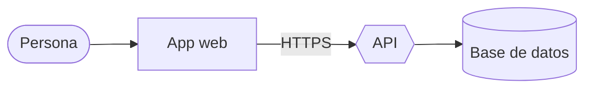

<p align="center"></p>

<h1 align="center">Esquema</h1>

<p align="center"><b>Diagramas y documentación que GitHub ya entiende.</b><br>
Escribe Mermaid o dibuja en el lienzo: los dos se mantienen al día. Gratis, abierto y en tu computador.</p>

<p align="center"><a href="#english">English below</a></p>


## Qué es

Esquema es una app para hacer **diagramas de flujo, secuencia y arquitectura** y la **documentación** que los acompaña. Usa el
formato que GitHub ya muestra (Markdown con bloques ```` ```mermaid ```` y archivos `.mmd`), pero con lo que a Mermaid le falta:

- **Edición en dos sentidos.** Escribe el texto con autocompletar y errores claros en español («Línea 4: falta cerrar «]» en
  «B[Pagar». Prueba: B[Pagar]»), o dibuja: doble clic para crear o renombrar, arrastra desde un nodo para conectarlo, mueve lo que
  quieras (queda fijado), Supr para borrar, ⌘Z para deshacer. Cada cambio aparece al tiro en el texto, tocando solo esa línea.
- **Un motor propio, rápido y liviano**: entre 40 y 100 veces más rápido que Mermaid, sin dependencias ([medición](#rendimiento)).
- **Documentos con diagramas que se editan en el lugar**, vista previa en vivo, enlaces que nunca cargan nada de internet.
- **Tu IA te ayuda** (Claude Code, Codex o Gemini, con tu cuenta): «Dibújame» propone un diagrama desde lo que describes, y el
  asistente **README para GitHub** escribe el README de tu proyecto con la lista de archivos (solo nombres, respetando `.gitignore`,
  nunca secretos). Cada cambio de la IA tiene su tarjeta con **«Quitar este cambio»**.
- **Plantillas** de arquitectura, secuencia de API, flujo de usuario, proceso de negocio, README, decisión de arquitectura (ADR) y
  runbook. **Exporta** a SVG, PNG, Markdown o «Copiar para GitHub».
- Íconos de arquitectura propios, claro y oscuro, español e inglés, y lo primero que pregunta es tu idioma.

| Documento con sus diagramas | Secuencia editable | README con tu IA |
|---|---|---|
|  |  |  |

<p align="center"> </p>

## Tus archivos, en formato abierto

Esquema trabaja con los `.md` y `.mmd` de la carpeta que eliges (la de tu proyecto, por ejemplo). No los mueve, no los copia, no los
manda a ninguna parte y no deja archivos ocultos. Lo que agrega para el lienzo (posiciones fijadas a mano, íconos, estilo de las
flechas) va en una línea de comentario que Mermaid ignora:



GitHub lo muestra como siempre; Esquema le pone los íconos. El subconjunto de Mermaid que lee y escribe está en
[AGENTS.md](AGENTS.md#subconjunto-de-mermaid); otros tipos (gantt, ER, estados…) se dejan intactos hasta que lleguen.

## Rendimiento

Mismo navegador (Chromium), mismos diagramas, mediana de varias pasadas. Mermaid 12.2.0 (5,4 MB minificado) contra el motor de
Esquema (117 KB sin minificar), medido con [`herramientas/comparar_mermaid.mjs`](herramientas/comparar_mermaid.mjs):

| Diagrama | Mermaid | Esquema (desde cero) | Esquema (al editar) |
|---|---:|---:|---:|
| Flujo, 50 nodos | 423 ms | 7 ms | 3 ms |
| Flujo, 200 nodos | 1.388 ms | 32 ms | 12 ms |
| Flujo, 1.000 nodos | 7.729 ms | 75 ms | 59 ms |
| Secuencia, 50 mensajes | 70 ms | 1 ms | 1 ms |
| Secuencia, 200 mensajes | 217 ms | 3 ms | 3 ms |

«Al editar» es lo que pasa en cada tecla: si el cambio no mueve nada, no se vuelve a acomodar y solo se reemplaza lo que cambió.

## Estado

Esta es la **primera fase: el núcleo web** (motor, interfaz, plantillas, IA y pruebas), que ya corre en el navegador con una carpeta
de ejemplo ficticia. Las apps de **Mac, Windows y Linux** vienen en la fase siguiente, con la misma interfaz. Lo planificado (BPMN,
estados, ER, gantt, mapa mental, catálogo de plantillas de la comunidad) está en [AGENTS.md](AGENTS.md#lo-que-viene-fase-siguiente-y-planificado).

## Desarrollo

```bash
cd ui && python3 -m http.server 8765      # http://localhost:8765 (?idioma=en, ?bienvenida, ?vacio)
bash pruebas/correr.sh                    # todas las pruebas (la interfaz necesita Playwright)
node herramientas/comparar_mermaid.mjs    # rendimiento y compatibilidad contra Mermaid real (lo instala aparte)
```

Lee [AGENTS.md](AGENTS.md) (sirve igual para personas y para tu IA) y [CONTRIBUTING.md](CONTRIBUTING.md). Las fallas de seguridad
se reportan en privado: [SECURITY.md](SECURITY.md).

## Licencia

[AGPL-3.0](LICENSE). Sin cuentas, sin publicidad, sin telemetría.

---

<a id="english"></a>

## English

**Esquema** makes **flowcharts, sequence and architecture diagrams** and the **documentation** around them, in the format GitHub
already renders (Markdown with ```` ```mermaid ```` blocks and `.mmd` files), plus what Mermaid is missing:

- **Two-way editing**: type Mermaid with autocomplete and clear errors (line, what's missing, a suggestion), or draw on the canvas —
  double-click to create or rename, drag from a node to connect, move nodes (they stay pinned), Delete, ⌘Z. Every canvas change is
  a minimal edit to the text, keeping your comments and formatting.
- **Its own fast, dependency-free engine**: 40–100× faster than Mermaid ([benchmark](#rendimiento)).
- **Documents** with diagrams you edit in place and a live preview that never loads anything from the internet.
- **Your own AI** (Claude Code, Codex or Gemini, with your account): “Draw it” proposes a diagram from a description, and the
  **README for GitHub** assistant writes your project's README from the file list (names only, respecting `.gitignore`, never
  secrets). Every AI change has a card with **“Remove this change”**.
- **Templates** (architecture, API sequence, user flow, business process, README, ADR, runbook) and **export** to SVG, PNG, Markdown
  or “Copy for GitHub”. Own architecture icons, light and dark, Spanish and English; the first thing it asks is your language.

Your files stay yours: plain `.md`/`.mmd` in the folder you choose. Esquema-only data (pinned positions, icons) lives in a
`%% esquema: {...}` comment that Mermaid ignores. This is phase one, the web core; the Mac, Windows and Linux apps come next.
Run it with `cd ui && python3 -m http.server 8765`, test with `bash pruebas/correr.sh`. Licensed under [AGPL-3.0](LICENSE).
