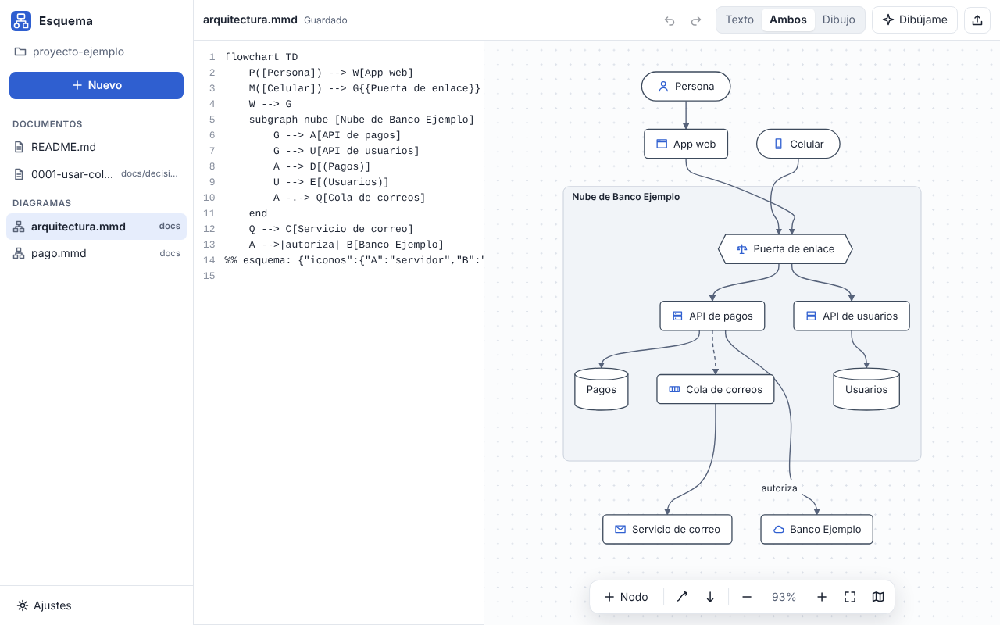
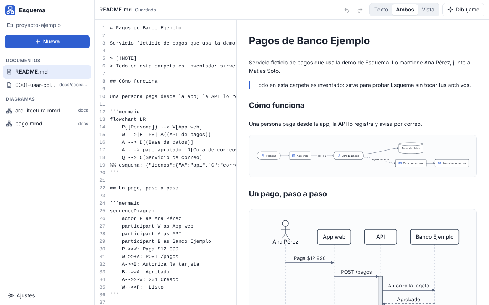
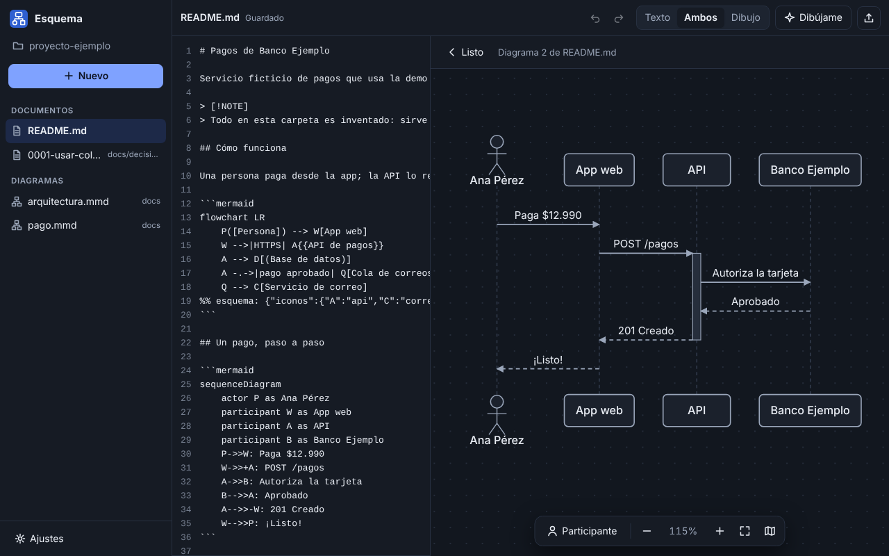
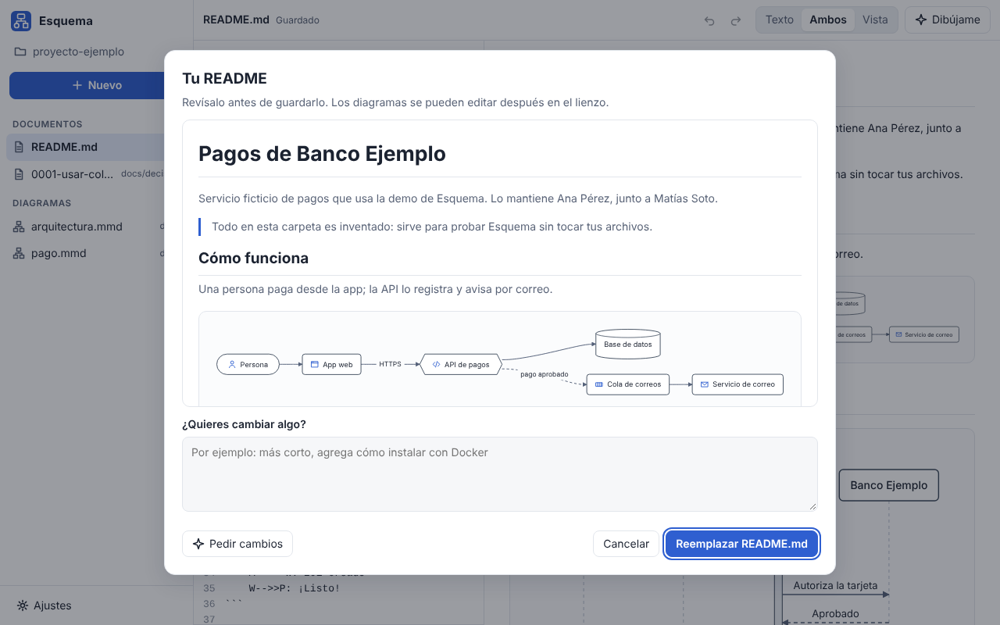
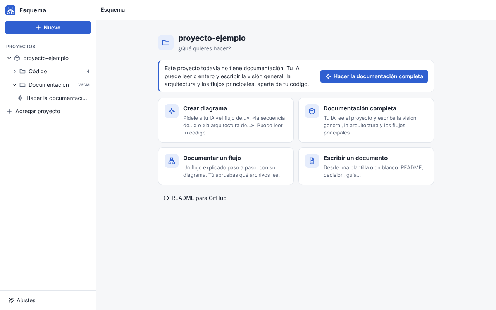
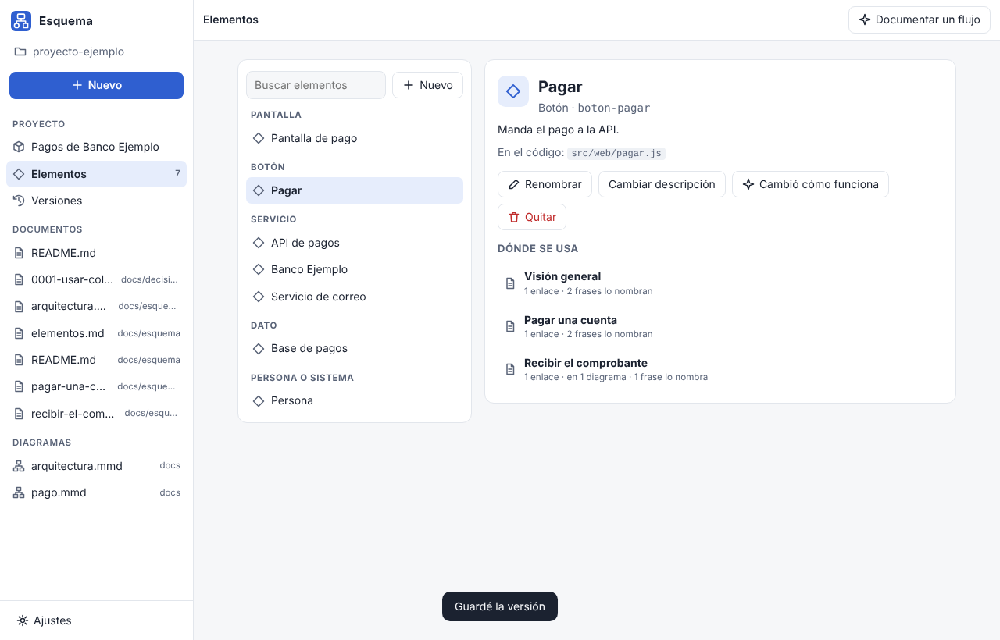
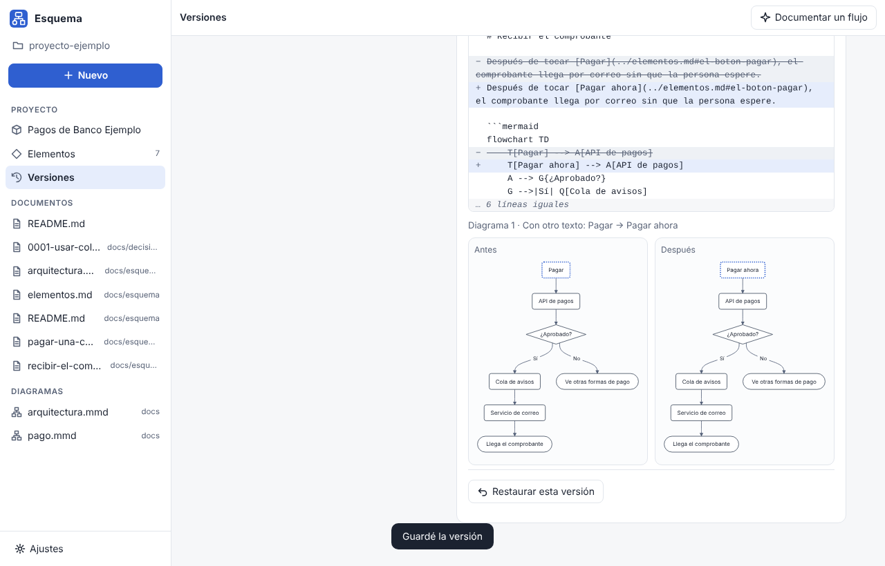
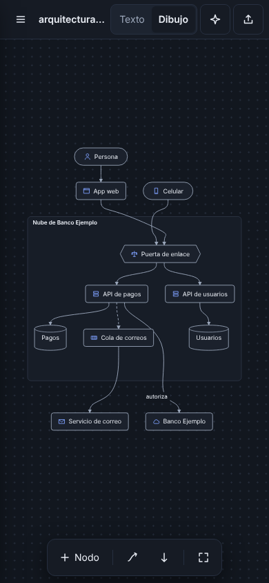
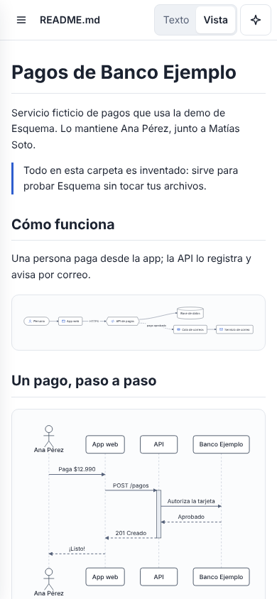

<p align="center"></p>

<h1 align="center">Esquema</h1>

<p align="center"><b>Diagramas y documentación que GitHub ya entiende.</b><br>
Escribe Mermaid o dibuja en el lienzo: los dos se mantienen al día. Gratis, abierto y en tu computador.</p>

<p align="center"><a href="https://esquema-app.github.io/esquema/"><b>Sitio y descargas</b></a> · <a href="https://esquema-app.github.io/esquema/demo/">Pruébala en el navegador</a> · <a href="https://github.com/esquema-app/esquema-catalogo">Plantillas de la comunidad</a> · <a href="https://github.com/esquema-app/esquema/discussions">Comunidad</a> · <a href="#english">English below</a></p>



## Qué es

Esquema es una app para hacer **diagramas de flujo, secuencia y arquitectura** y la **documentación** que los acompaña. Usa el
formato que GitHub ya muestra (Markdown con bloques ```` ```mermaid ```` y archivos `.mmd`), pero con lo que a Mermaid le falta:

- **Edición en dos sentidos.** Escribe el texto con autocompletar y errores claros en español («Línea 4: falta cerrar «]» en
  «B[Pagar». Prueba: B[Pagar]»), o dibuja: doble clic para crear o renombrar, arrastra desde un nodo para conectarlo, mueve lo que
  quieras (queda fijado), Supr para borrar, ⌘Z para deshacer. Cada cambio aparece al tiro en el texto, tocando solo esa línea.
- **Un motor propio, rápido y liviano**: entre 40 y 100 veces más rápido que Mermaid, sin dependencias ([medición](#rendimiento)).
- **Documentos con diagramas que se editan en el lugar**, vista previa en vivo, enlaces que nunca cargan nada de internet.
- **Tu carpeta, de un vistazo.** A la izquierda, la carpeta entera como árbol (cada subcarpeta se abre y se cierra). Al elegirla,
  el **Inicio** ofrece lo que se puede hacer: **Crear diagrama**, **Documentación completa**, **Documentar un flujo** y **Escribir un
  documento**.
- **Tu IA te ayuda** (Claude Code, Codex o Gemini, con tu cuenta): pídele «el flujo de…», «la secuencia de…» o «la arquitectura
  de…» y elige el tipo de diagrama por cómo lo pides. **Crear diagrama** puede leer el código de la carpeta (antes de enviar ves
  exactamente qué va) o solo tu descripción, y «Dibújame» cambia el diagrama que tienes abierto. El
  asistente **README para GitHub** escribe el README de tu proyecto con la lista de archivos (solo nombres, respetando `.gitignore`,
  nunca secretos). Cada cambio de la IA tiene su tarjeta con **«Quitar este cambio»**.
- **Proyectos: documentación que crece con tu código, aparte del código.** Agrega los proyectos que quieras (cada uno es la carpeta
  de un repositorio): Esquema lee el README, las guías, los archivos y la historia de git (sin IA, nada sale de tu computador) y tu
  IA escribe la visión general, la arquitectura y los flujos principales en **su propia carpeta**, `~/Esquema/<proyecto>/`, con su
  propio historial de versiones: tu repo no cambia. Con **«Pasar al proyecto»** eliges qué documentos copiar al repo (y si
  reemplazas los que ya existen, viendo la diferencia). Después pídele un flujo específico («cómo se
  graba una reunión»): si necesita leer archivos del código te pregunta cuáles, y antes de cada envío ves exactamente qué se manda.
  Con **«Revisión a fondo»** tu IA puede además leer (solo leer) toda la carpeta del código, nunca tus `.env`, llaves ni `.git`. A la
  izquierda, cada proyecto es una carpeta con su **Código** y su **Documentación**, y la documentación te dice **qué le falta**
  (visión, arquitectura, flujos, elementos) y la completa con un botón.
- **Todo conectado.** Pantallas, botones y servicios son **elementos** (`esquema.json`); los diagramas y los textos los enlazan. Si
  renombras o quitas un botón, Esquema muestra cada documento y diagrama que cambia (antes y después, lo que queda suelto) y lo
  aplica todo en una sola versión que puedes deshacer. Si algo ahora funciona distinto, tu IA propone el cambio en cada documento.
- **Versiones.** Cada «Guardar versión» es un commit de git **solo** de la carpeta de la documentación (sin git, una copia en
  `.versiones/`). Compara versiones (texto y diagramas, con lo nuevo y lo quitado marcado) y restaura cualquiera. Si el código
  cambió desde tu última versión, Esquema te dice qué documentos podrían estar desactualizados.
- **Plantillas** de arquitectura, secuencia de API, flujo de usuario, proceso de negocio, README, decisión de arquitectura (ADR) y
  runbook, y las del [catálogo de la comunidad](https://github.com/esquema-app/esquema-catalogo) en «Nuevo» → «Comunidad» (se
  descargan con su huella revisada). **Exporta** a SVG, PNG, Markdown o «Copiar para GitHub».
- Íconos de arquitectura propios, claro y oscuro, español e inglés, y lo primero que pregunta es tu idioma.

| Documento con sus diagramas | Secuencia editable | README con tu IA |
|---|---|---|
|  |  |  |

| Inicio: tu carpeta como árbol y lo que puedes hacer | Proyecto: elementos conectados en todos los documentos | Versiones: comparar texto y diagramas, y restaurar |
|---|---|---|
|  |  |  |

<p align="center"> </p>

## Tus archivos, en formato abierto

Esquema trabaja con los `.md` y `.mmd` de la carpeta que eliges (la de tu proyecto, por ejemplo). No los mueve, no los copia, no los
manda a ninguna parte y no deja archivos ocultos. Lo que agrega para el lienzo (posiciones fijadas a mano, íconos, estilo de las
flechas) va en una línea de comentario que Mermaid ignora:


GitHub lo muestra como siempre; Esquema le pone los íconos. El subconjunto de Mermaid que lee y escribe está en
[AGENTS.md](AGENTS.md#subconjunto-de-mermaid); otros tipos (gantt, ER, estados…) se dejan intactos hasta que lleguen.

Un **proyecto** guarda su documentación dentro del mismo repositorio, para que crezca y se versione con el código:

```
docs/esquema/
├── README.md              visión general (GitHub la muestra al abrir la carpeta)
├── arquitectura.md
├── flujos/grabar-una-reunion.md
├── elementos.md           el glosario: lo escribe Esquema, con un ancla por elemento
└── esquema.json           nombre, documentos y elementos (formato abierto, en AGENTS.md)
```

Un diagrama dice qué nodo es cada elemento en la misma línea de Esquema (`%% esquema: {"refs": {"G": "boton-grabar"}}`) y el texto lo
enlaza con un enlace normal al glosario: `[Grabar](elementos.md#el-boton-grabar)`. En GitHub se lee como siempre y el enlace lleva a
la ficha del elemento.

## Rendimiento

Mismo navegador (Chromium), mismos diagramas, mediana de varias pasadas. Mermaid 12.2.0 (5,4 MB minificado) contra el motor de
Esquema (117 KB sin minificar), medido con [`herramientas/comparar_mermaid.mjs`](herramientas/comparar_mermaid.mjs):

| Diagrama | Mermaid | Esquema (desde cero) | Esquema (al editar) |
|---|---:|---:|---:|
| Flujo, 50 nodos | 423 ms | 7 ms | 3 ms |
| Flujo, 200 nodos | 1.388 ms | 32 ms | 12 ms |
| Flujo, 1.000 nodos | 7.729 ms | 75 ms | 59 ms |
| Secuencia, 50 mensajes | 70 ms | 1 ms | 1 ms |
| Secuencia, 200 mensajes | 217 ms | 3 ms | 3 ms |

«Al editar» es lo que pasa en cada tecla: si el cambio no mueve nada, no se vuelve a acomodar y solo se reemplaza lo que cambió.

## Instalar

En el [sitio](https://esquema-app.github.io/esquema/#descargar) está el botón para tu sistema. Esquema es gratis y no pide cuenta. Cada instalador baja la última versión publicada en GitHub, **verifica su huella SHA-256** y la
instala solo para tu usuario (sin contraseña de administrador). Tus documentos quedan en tu carpeta y nunca se tocan; la
configuración va en `~/Library/Application Support/Esquema` (Mac), `%APPDATA%\Esquema` (Windows) o `~/.config/esquema` (Linux).

**Mac** (Apple Silicon, macOS 15 o posterior), en la Terminal:

```bash
curl -fsSL https://raw.githubusercontent.com/esquema-app/esquema/main/instalar.sh | bash
```

**Windows** (10 u 11, 64 bits), en PowerShell:

```powershell
irm https://raw.githubusercontent.com/esquema-app/esquema/main/instalar.ps1 | iex
```

**Linux** (x86_64): el mismo comando de Mac (instala en `~/.local/share/Esquema` con su lanzador `esquema`), o baja de
[Releases](https://github.com/esquema-app/esquema/releases) el `Esquema-Linux.AppImage` o el `Esquema-Linux.deb`
(`sudo apt install ./Esquema-Linux.deb`; el .deb no se actualiza solo: baja el nuevo).

> **App sin firmar.** Esquema no paga los certificados de Apple ni de Microsoft, así que el sistema puede avisar la primera vez.
> Con los instaladores de arriba no pasa en Mac (quitan la cuarentena después de verificar la huella). Si bajaste el `.zip` a
> mano: clic derecho en Esquema.app → **Abrir** → **Abrir**. En Windows, si aparece «Windows protegió tu PC»: **Más información** →
> **Ejecutar de todas formas**. El código de cada versión está en este repo y cada descarga tiene su `.sha256` en el Release.

Las versiones nuevas se avisan **dentro de la app** (Ajustes → Actualizaciones): se bajan solo desde los Releases de este repo, se
verifica su huella y la app se cierra y vuelve a abrir sola, sin perder lo que estabas escribiendo.

## Estado

El núcleo (motor, interfaz, plantillas, IA y pruebas) corre en el navegador con una carpeta de ejemplo ficticia y en las apps de
**Mac** (nativa, SwiftPM + WKWebView) y **Windows y Linux** (Electron), con la misma interfaz. Las apps vigilan tu carpeta: si
cambias un archivo en otro editor (VS Code, `git pull`…), Esquema lo recarga; si tenías cambios sin guardar, te pregunta con cuál
versión quedarte. Las plantillas de la comunidad llegan desde [esquema-catalogo](https://github.com/esquema-app/esquema-catalogo).
Lo planificado (BPMN, estados, ER, gantt, mapa mental) está en [AGENTS.md](AGENTS.md#lo-que-viene-planificado).

## Comunidad

- **Comparte una plantilla** sin programar: descríbela con palabras en
  [«Proponer una plantilla»](https://github.com/esquema-app/esquema-catalogo/issues/new?template=plantilla.yml) y la armamos (CC0).
- **Conversa** en [Discussions](https://github.com/esquema-app/esquema/discussions): dudas, ideas y lo que documentaste.
- **Aporta:** prueba en Windows o Linux, traduce o toma una
  [tarea de bienvenida](https://github.com/esquema-app/esquema/labels/good%20first%20issue). Detalle en [CONTRIBUTING.md](CONTRIBUTING.md).

## Desarrollo

```bash
cd ui && python3 -m http.server 8765      # http://localhost:8765 (?idioma=en, ?bienvenida, ?vacio)
node herramientas/pagina_capturas.mjs     # la página (docs/) como en GitHub Pages, con la demo en /demo/
bash pruebas/correr.sh                    # todas las pruebas (la interfaz necesita Playwright)
node herramientas/comparar_mermaid.mjs    # rendimiento y compatibilidad contra Mermaid real (lo instala aparte)
bash build.sh                             # Mac: compila e instala en ~/Applications/Esquema.app
cd escritorio && npm ci && node node_modules/electron/install.js && npx electron .   # Windows y Linux, sin empaquetar
```

Lee [AGENTS.md](AGENTS.md) (sirve igual para personas y para tu IA) y [CONTRIBUTING.md](CONTRIBUTING.md). Las fallas de seguridad
se reportan en privado: [SECURITY.md](SECURITY.md).

## Licencia

[AGPL-3.0](LICENSE). Sin cuentas, sin publicidad, sin telemetría.

---

<a id="english"></a>

## English

**Esquema** makes **flowcharts, sequence and architecture diagrams** and the **documentation** around them, in the format GitHub
already renders (Markdown with ```` ```mermaid ```` blocks and `.mmd` files), plus what Mermaid is missing:

- **Two-way editing**: type Mermaid with autocomplete and clear errors (line, what's missing, a suggestion), or draw on the canvas —
  double-click to create or rename, drag from a node to connect, move nodes (they stay pinned), Delete, ⌘Z. Every canvas change is
  a minimal edit to the text, keeping your comments and formatting.
- **Its own fast, dependency-free engine**: 40–100× faster than Mermaid ([benchmark](#rendimiento)).
- **Documents** with diagrams you edit in place and a live preview that never loads anything from the internet.
- **Your folder at a glance.** On the left, the whole folder as a tree (each subfolder opens and closes). When you pick it, **Home**
  offers what you can do: **Create a diagram**, **Full documentation**, **Document a flow** and **Write a document**.
- **Your own AI** (Claude Code, Codex or Gemini, with your account): ask for “the flow of…”, “the sequence of…” or “the
  architecture of…” and the diagram type follows how you ask. **Create a diagram** can read the folder's code (you see exactly what
  goes before sending) or just your description, and “Draw it” changes the diagram you have open. The
  **README for GitHub** assistant writes your project's README from the file list (names only, respecting `.gitignore`, never
  secrets). Every AI change has a card with **“Remove this change”**.
- **Projects: documentation that grows with your code, kept apart from it.** Add as many projects as you want (each one is a
  repository folder): Esquema reads the README, guides, files and git history (no AI, nothing leaves your computer) and your AI
  writes the overview, architecture and main flows in **their own folder**, `~/Esquema/<project>/`, with its own version history:
  your repo doesn't change. With **“Copy to project”** you choose which documents go into the repo (and whether to replace the ones
  that exist, seeing the difference). Ask for a specific flow later; if it needs to read code files it asks which ones, and
  before every request you see exactly what gets sent.
  With **“Thorough review”** your AI can also read (only read) the whole code folder, never your `.env`, keys or `.git`. On the
  left, each project is a folder with its **Code** and its **Documentation**, and the documentation tells you **what it's missing**
  (overview, architecture, flows, elements) and completes it with one button.
- **Everything connected.** Screens, buttons and services are **elements** (`esquema.json`) that diagrams and text link to. Rename
  or remove a button and Esquema previews every document and diagram that changes, then applies it all as one version you can undo.
- **Versions.** Each “Save version” is a git commit of **only** the documentation folder (without git, a copy in `.versiones/`).
  Compare versions (text and diagrams) and restore any of them; when the code changed since your last version, Esquema tells you
  which documents may be out of date.
- **Templates** (architecture, API sequence, user flow, business process, README, ADR, runbook) and **export** to SVG, PNG, Markdown
  or “Copy for GitHub”. Own architecture icons, light and dark, Spanish and English; the first thing it asks is your language.

Your files stay yours: plain `.md`/`.mmd` in the folder you choose. Esquema-only data (pinned positions, icons) lives in a
`%% esquema: {...}` comment that Mermaid ignores. The apps watch your folder: if you edit a file in another editor, Esquema reloads it
(and asks which version to keep if you had unsaved changes).

**Website, downloads and live demo:** [esquema-app.github.io/esquema](https://esquema-app.github.io/esquema/?lang=en). **Community
templates** (CC0) come from [esquema-catalogo](https://github.com/esquema-app/esquema-catalogo) under “New” → “Community”; propose one in
plain words with the [template form](https://github.com/esquema-app/esquema-catalogo/issues/new?template=plantilla.yml). Questions and
ideas: [Discussions](https://github.com/esquema-app/esquema/discussions); good first issues are labeled
[`good first issue`](https://github.com/esquema-app/esquema/labels/good%20first%20issue).

**Install** (free, no account; each installer downloads the latest GitHub Release, checks its SHA-256 and installs for your user only):

- Mac (Apple Silicon, macOS 15+) and Linux (x86_64): `curl -fsSL https://raw.githubusercontent.com/esquema-app/esquema/main/instalar.sh | bash`
- Windows 10/11 (PowerShell): `irm https://raw.githubusercontent.com/esquema-app/esquema/main/instalar.ps1 | iex`
- Linux also: `Esquema-Linux.AppImage` or `Esquema-Linux.deb` from [Releases](https://github.com/esquema-app/esquema/releases).

The apps are **not signed** (no Apple/Microsoft certificates). The Mac installer removes the quarantine after checking the hash; if you
downloaded the zip by hand, right-click Esquema.app → **Open**. On Windows, “Windows protected your PC” → **More info** → **Run anyway**.
Updates are offered inside the app (Settings → Updates), only from this repo's Releases and verified by hash.

Run the web preview with `cd ui && python3 -m http.server 8765`, test with `bash pruebas/correr.sh`. Licensed under [AGPL-3.0](LICENSE).
