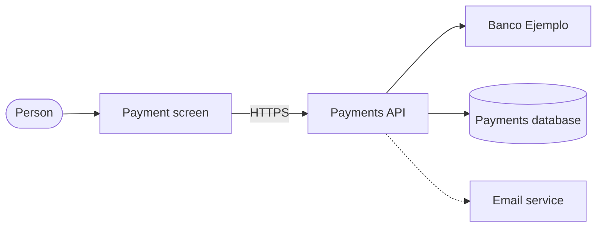

# Architecture

The [Payment screen](elementos.md#el-pantalla-pago) only talks to the [Payments API](elementos.md#el-api-pagos); the API is the only one that talks to [Banco Ejemplo](elementos.md#el-banco-ejemplo) and the database.

