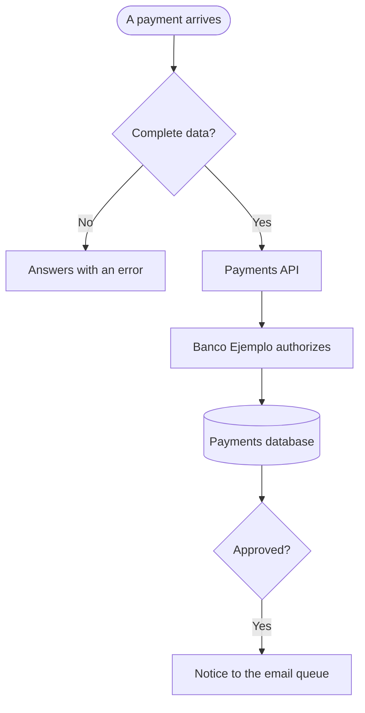

# {titulo}

What the [Payments API](../elementos.md#el-api-pagos) does with each payment, according to `src/api/pagos.py`.

1. If the account or the amount is missing, it answers with an error.
2. It asks [Banco Ejemplo](../elementos.md#el-banco-ejemplo) for the authorization.
3. It saves the result in the [Payments database](../elementos.md#el-base-pagos) and, if approved, leaves the notice for the receipt.
