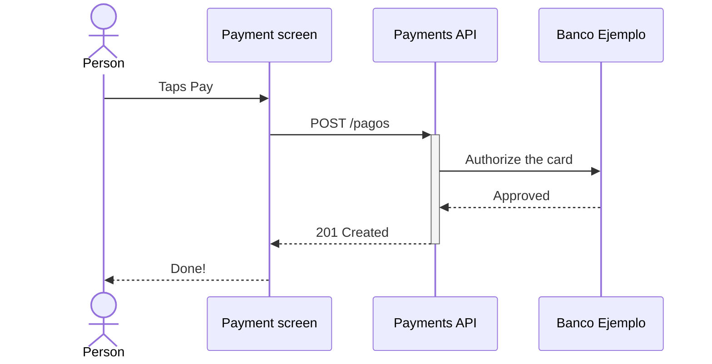

# Pay a bill

The person picks what to pay on the [Payment screen](../elementos.md#el-pantalla-pago) and taps [Pay](../elementos.md#el-boton-pagar). The [Payments API](../elementos.md#el-api-pagos) asks for the authorization and answers in less than a second.

