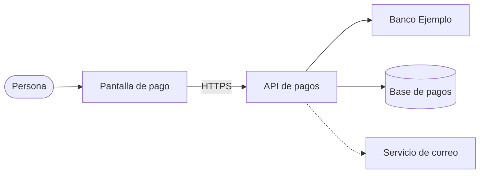

# Arquitectura

La [Pantalla de pago](elementos.md#el-pantalla-pago) habla solo con la [API de pagos](elementos.md#el-api-pagos); la API es la única que conversa con [Banco Ejemplo](elementos.md#el-banco-ejemplo) y con la base.

