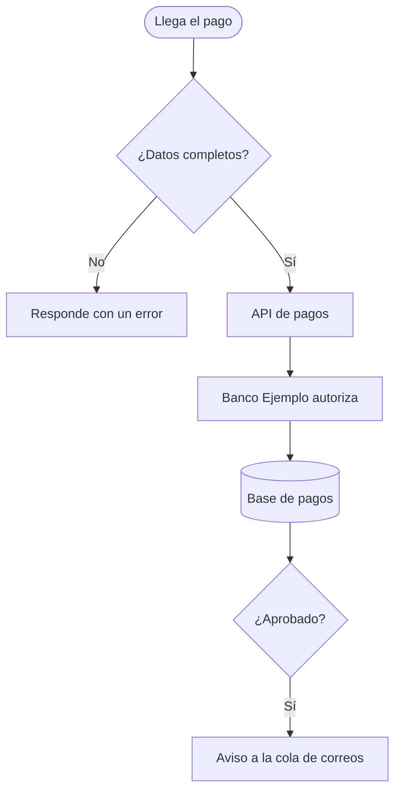

# {titulo}

Lo que hace la [API de pagos](../elementos.md#el-api-pagos) con cada pago, según `src/api/pagos.py`.

1. Si falta la cuenta o el monto, responde con un error.
2. Pide la autorización a [Banco Ejemplo](../elementos.md#el-banco-ejemplo).
3. Guarda el resultado en la [Base de pagos](../elementos.md#el-base-pagos) y, si se aprobó, deja el aviso para el comprobante.
