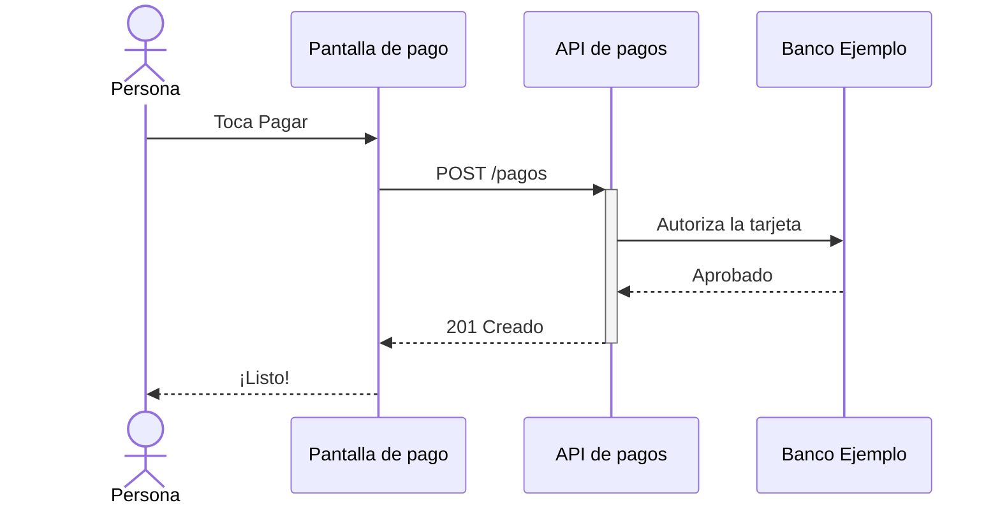

# Pagar una cuenta

La persona elige qué pagar en la [Pantalla de pago](../elementos.md#el-pantalla-pago) y toca [Pagar](../elementos.md#el-boton-pagar). La [API de pagos](../elementos.md#el-api-pagos) pide la autorización y responde en menos de un segundo.

