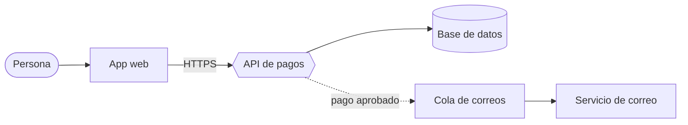
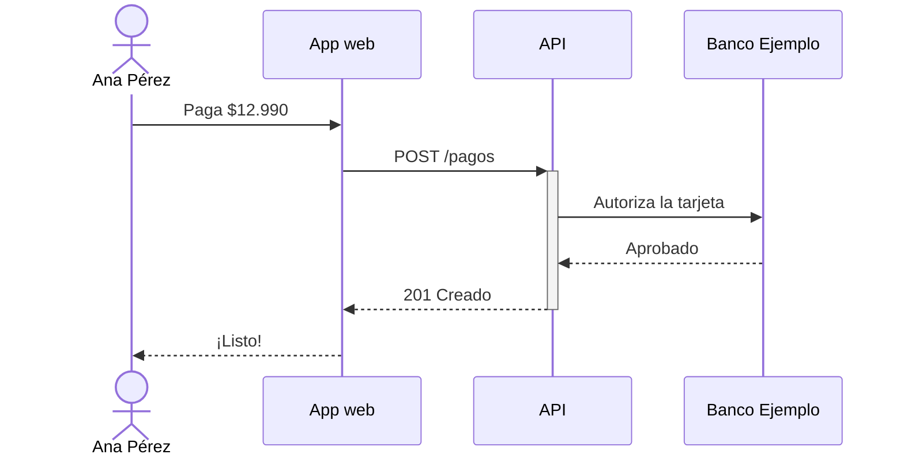

# Pagos de Banco Ejemplo

Servicio ficticio de pagos que usa la demo de Esquema. Lo mantiene Ana Pérez, junto a Matías Soto.

> [!NOTE]
> Todo en esta carpeta es inventado: sirve para probar Esquema sin tocar tus archivos.

## Cómo funciona

Una persona paga desde la app; la API lo registra y avisa por correo.

## Un pago, paso a paso

## Documentos

- [Arquitectura](docs/arquitectura.mmd)
- [Flujo de un pago](docs/pago.mmd)
- [Decisión: usar una cola para los correos](docs/decisiones/0001-usar-cola.md)

## Licencia

AGPL-3.0
