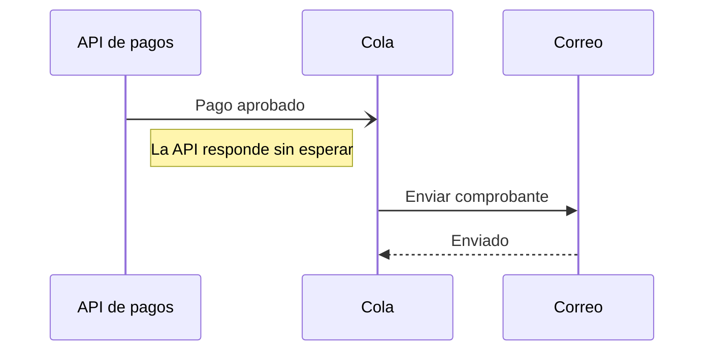

# 1. Usar una cola para los correos

- **Estado:** aceptada
- **Fecha:** 2026-03-12
- **Quién:** Matías Soto

## Contexto

Cuando el servicio de correo se demora, la API de pagos también se demora y algunas personas pagan dos veces.

## Decisión

La API deja el aviso en una cola y sigue; el servicio de correo lo envía cuando puede.

## Consecuencias

- Los pagos responden en menos de un segundo aunque el correo falle.
- Hay que vigilar que la cola no crezca: alerta si pasa de 1.000 avisos.
